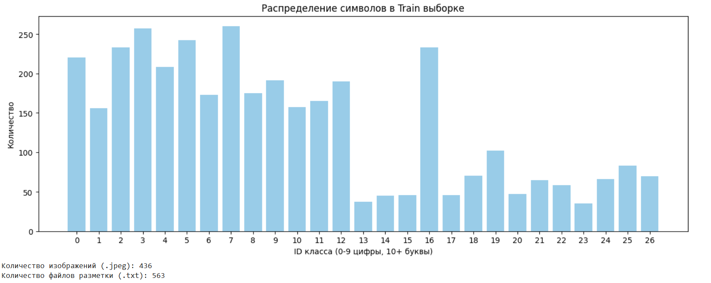
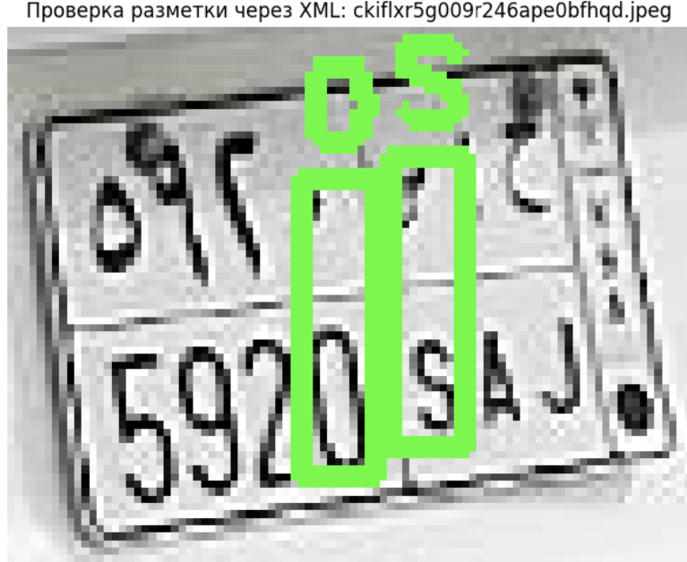
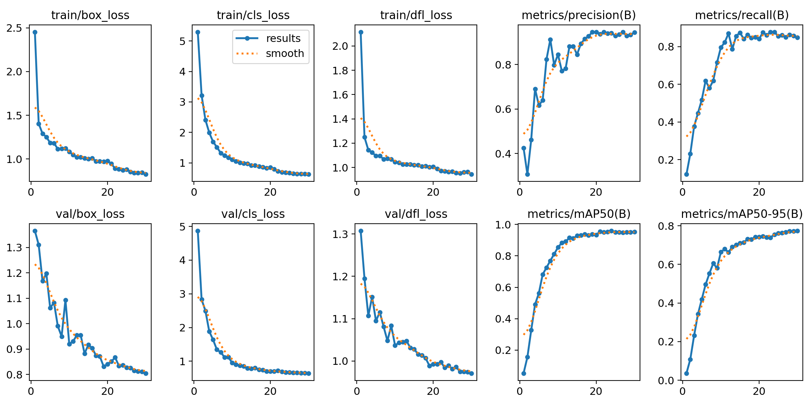
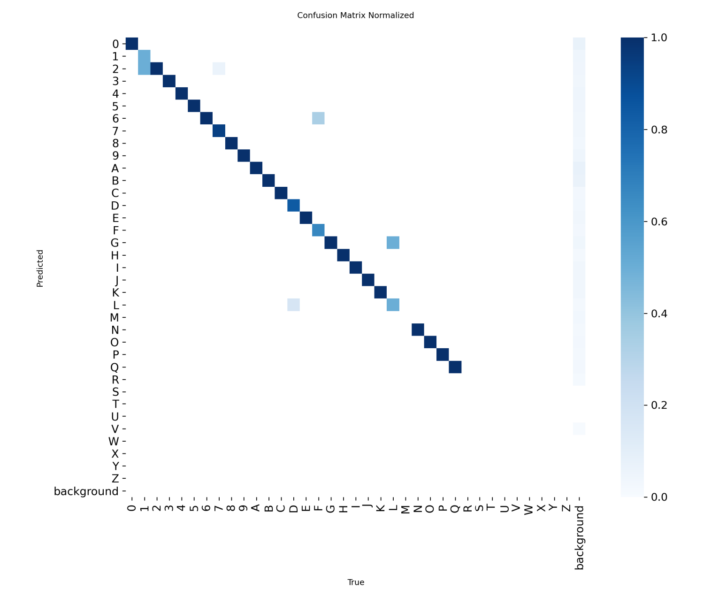
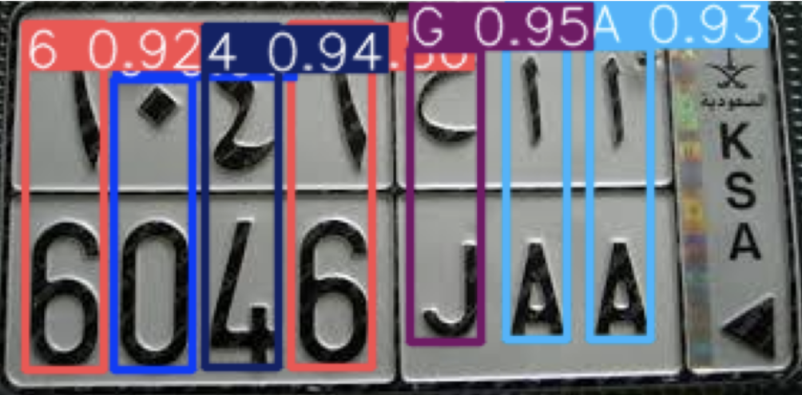
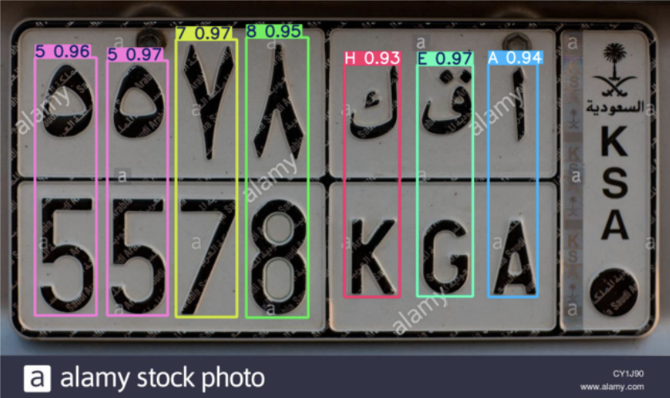
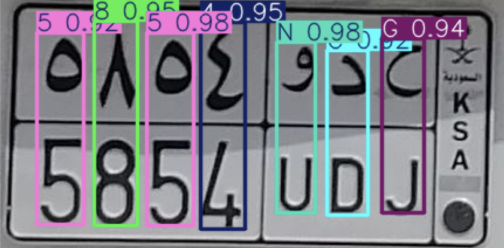

# Detection_Number_Plate_KSA
# Детекция символов на номерах KSA (Саудовская Аравия)
**Задача:** Необходимо сделать анализ датасета и разработать детектор на Python.
## Материалы проекта
* **[Все материалы (Датасет, Ноутбук, Word отчет (тот же Readme) на Google Диске](https://drive.google.com/drive/folders/1_QhtPieMEJnIglwSI5L3gCJUGRK9ne0w?usp=sharing)**

**Выбранная модель:** YOLOv8n. Я выбрала эту нейросеть, потому что она современная, быстрая и отлично подходит для поиска объектов на картинках (Object Detection), показывая хорошие результаты даже на небольших данных.

## Анализ данных (EDA)

Сначала я визуально посмотрела на несколько картинок и файлов разметки. Я поняла, что это номера машин Саудовской Аравии (KSA). На основе этого я создала файл `data.yaml` с полным списком возможных классов (цифры 0-9 и английские буквы A-Z).

Затем я провела разведочный анализ (EDA), чтобы проверить, какие классы реально есть в выборке. Оказалось, что в датасете 436 картинок и 563 файла разметки для обучения, и 30 картинок для теста. Реально используется только 27 классов (цифры и буквы от A до Q). Буквы R-Z в разметке отсутствуют. Русских букв (кириллицы) там нет, так как это не наш стандарт.

На графике видно, что классы распределены неравномерно. Самый повторяющийся класс 16 (буква G), он встречается более 200 раз. Цифры (классы 0-9) тоже встречаются часто (в среднем по 150-250 раз). А вот многие буквы (например, 13, 14, 15, 17, 20, 23) представлены редко, менее 50 раз. Такой перекос означает, что модель будет лучше распознавать повторяющиеся символы и хуже редкие.

В папке лежали файлы двух видов: `.txt` (для нейросети) и `.xml` (с подробным описанием) и `.jpeg` (фото). Для обучения я брала `.txt`, так как YOLO понимает только его. А для визуальной проверки рамок взяла `.xml`, там координаты уже указаны в пикселях, и на картинке сразу пишутся сами буквы (например, L), а не их номера (например, 21).

Сами фото очень маленькие и пиксельные. Но YOLO перед обучением сама растягивает их до размера 640x640 и применяет аугментации (искусственные искажения), поэтому она нормально с ними справляется.

## Процесс обучения

Модель обучалась в течение 30 эпох.

Параметры: `batch_size=16` (брала по 16 картинок за раз), `imgsz=640` (размер картинок), `patience=10`.

Программа сама выбрала оптимизатор AdamW, это стандартный оптимизатор для обучения.

Во время обучения считались три ошибки: `box_loss` (за неправильные рамки), `cls_loss` (за неправильное определение буквы/цифры) и `dfl_loss` (за неточные границы).

На видеокарте Tesla T4 в Colab обучение заняло всего около 5 минут.

## Результаты и метрики

После проверки на тестовых 30 картинках модель показала:

* **mAP@50 = 95.3%** главный показатель точности. Требовалось минимум 80%, а мы получили почти 96%.
* **Precision (Точность) = 0.944**, модель почти не ошибается, когда говорит, что нашла букву.
* **Recall (Полнота) = 0.849**, модель находит большинство символов на картинке.

По матрице ошибок видно, что модель хорошо различает символы. Иногда она путает похожие знаки (например, 8 и B или 0 и O), а также редкие буквы (D, F, K), которых в обучающей выборке было мало (меньше 20 штук).

## Визуализация работы модели на тестовой выборке:

## Выводы

В итоге я обучила детектор на базе YOLOv8n. Точность 95.3% полностью решает задачу. Главная проблема это дисбаланс классов. Буквы F, D, K встречаются редко, поэтому модель их распознает чуть хуже. Чтобы это исправить в будущем, можно добавить специальные аугментации для редких букв или просто собрать больше таких фото.

Также я заметила один нюанс, на верхней строке номера есть арабская вязь, и модель пытается найти там знакомые буквы, хотя их там нет. Это потому, что в обучающих данных были только цифры и латиница, а арабских букв не было. Если добавить их в разметку, модель выучит и их.

Этот метод (поиск объектов) можно применять и в АГРОЭКО,например, чтобы считать животных на ферме с камер или распознавать номера машин на въезде.
